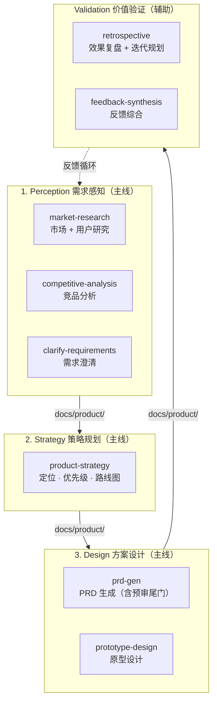
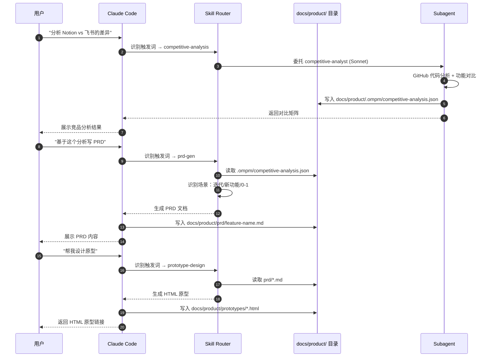
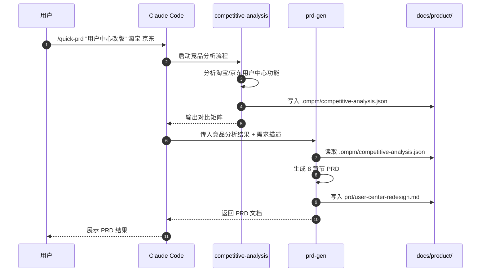
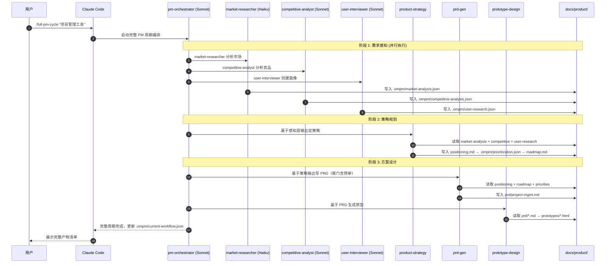
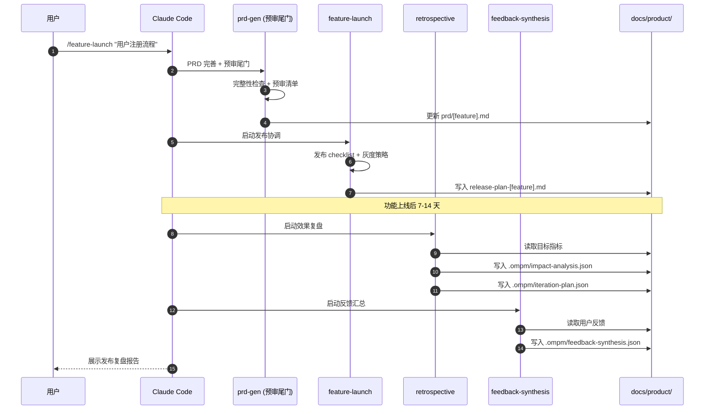
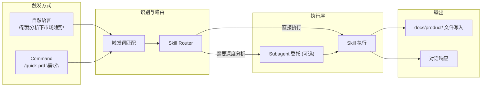
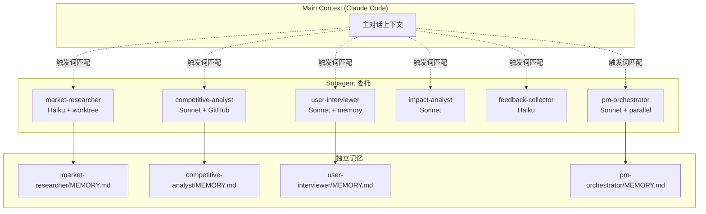
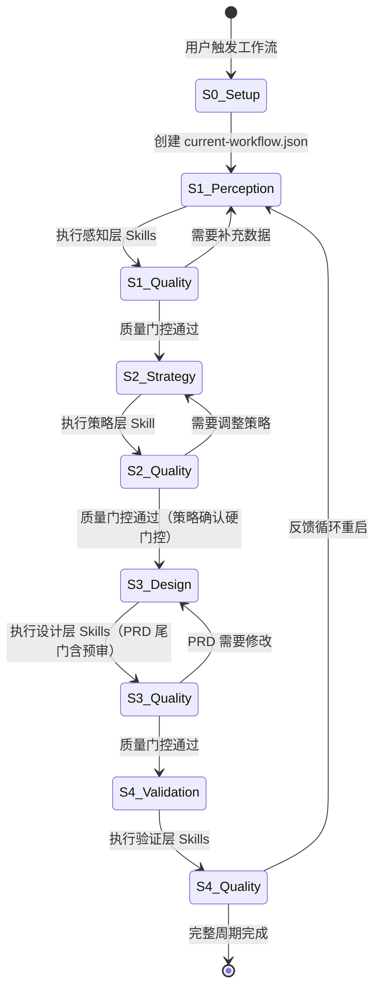
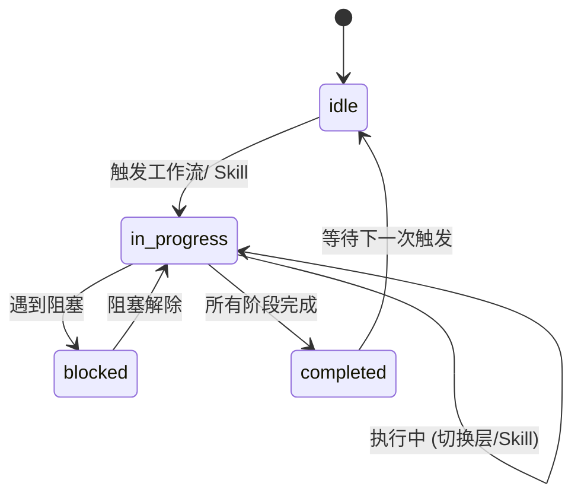

# Oh-My-PM 工作流架构 (v1.0.0)

Oh-My-PM 采用 **三层主线（感知 → 策略 → 设计）+ 验证辅助** 的架构 + **Plan-and-Execute 模式**，覆盖完整产品管理闭环。原交付层已取消：PRD 预审并入 `prd-gen` 尾门，发布 checklist / 灰度策略并入 `feature-launch`。

## 架构总览

## 用户对话流

用户通过 **自然语言** 或 **Command** 触发，系统自动识别并路由到对应 Skill。

## Command 工作流详解

4 个 Command 中，`/ompm` 是**全局意图路由**：无参数或自然语言输入时，读取当前对话上下文 + `docs/product/.ompm/current-workflow.json`，判断"当前最有价值的下一步"并说明理由；输入 workflow 名（`quick-prd` / `full-pm-cycle` / `feature-launch`）时直派到对应工作流，`/quick-prd` 等裸命令是等价的简写形式。

### /quick-prd — 竞品分析 + PRD

### /full-pm-cycle — 完整产品管理周期

### /feature-launch — 功能发布工作流

## 独立 Skill 使用流程

每个 Skill 可独立使用，不依赖工作流。

## Subagent 委托架构

## Plan-and-Execute 模式

### 阶段-层映射

| 阶段 | 层 | 执行内容 |
|:-----|:---|:---------|
| S0 Setup | — | 初始化 `current-workflow.json` |
| S1 Perception | 感知（主线 ①） | `market-research` · `competitive-analysis` · `clarify-requirements` |
| S2 Strategy | 策略（主线 ②） | `product-strategy`（策略确认硬门控） |
| S3 Design | 设计（主线 ③） | `prd-gen`（预审尾门） · `prototype-design` |
| S4 Validation | 验证（辅助） | `retrospective` · `feedback-synthesis` |

> 交付相关活动不再独立成阶段：PRD 预审是 `prd-gen` 的尾门（S3 内完成），发布 checklist / 灰度策略由 `feature-launch` 工作流承载。

## 质量门控标准

### Perception 层

| 门控 | 标准 | 指标 |
|:-----|:-----|:-----|
| 市场与用户研究完成 | 市场规模和趋势分析 + 3+ 用户访谈、2+ 用户画像 | `market_size`, `growth_rate`, `personas_created`, `interviews_conducted` |
| 竞品分析完成 | 2+ 竞品功能对比 | `competitors_analyzed`, `matrix_complete` |

### Strategy 层

| 门控 | 标准 | 指标 |
|:-----|:-----|:-----|
| 产品策略完成 | 定位声明 + RICE/MoSCoW 优先级排序 + 12 个月路线图 | `positioning_created`, `rice_scores_calculated`, `milestones_defined` |

### Design 层

| 门控 | 标准 | 指标 |
|:-----|:-----|:-----|
| PRD 完整并通过预审 | 8 章节 PRD 文档 + prd-gen 预审尾门通过 | `all_sections_complete`, `user_stories_mapped`, `prereview_passed` |
| 原型验证 | 原型生成 + 可用性确认 | `prototype_created`, `design_consistent` |

### Validation 层

| 门控 | 标准 | 指标 |
|:-----|:-----|:-----|
| 效果复盘完成 | 上线 7-14 天目标达成分析 + 下轮迭代计划 | `goals_achieved`, `variance_analyzed`, `next_iteration_planned` |
| 反馈综合完成 | 用户反馈主题分析 | `themes_identified`, `improvements_mapped` |

> 交付相关检查不再独立设门：PRD 预审并入 Design 层 `prd-gen` 尾门；发布 checklist / 灰度策略检查由 `feature-launch` 工作流内部把关。

## 状态机

## 版本历史

### v1.0.0
- 五层架构退役，改为三层主线（感知 → 策略 → 设计）+ 验证辅助；交付层取消（PRD 预审并入 prd-gen 尾门，发布 checklist/灰度策略并入 feature-launch）
- Skill 合并：market-intelligence + user-research → market-research；positioning + prioritization + roadmap → product-strategy；impact-analysis + iteration-planning → retrospective
- 删除 data-monitoring / process-optimization / requirement-review / project-coordination / release-management；Subagent 8 → 6（删除 data-monitor、process-optimizer）
- `/ompm` 升级为全局意图路由（无参/自然语言时读上下文 + current-workflow.json 推荐下一步）

### v0.9.4
- 上下文文件名统一为扁平 `.ompm/<name>.json` 契约（v0.9.3 起）
- 补充 `/ompm` 工作流调度器说明

### v0.8.0
- 新增 Mermaid 可视化工作流架构
- 新增完整对话流 sequence diagram
- 定义 5 层架构 + Plan-and-Execute 模式状态机
- 补充 Subagent 委托架构图

### v0.7.0 (之前)
- 定义工作流阶段、状态机和统一质量门控
