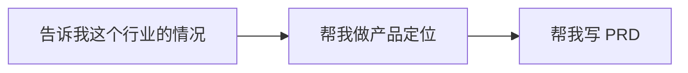
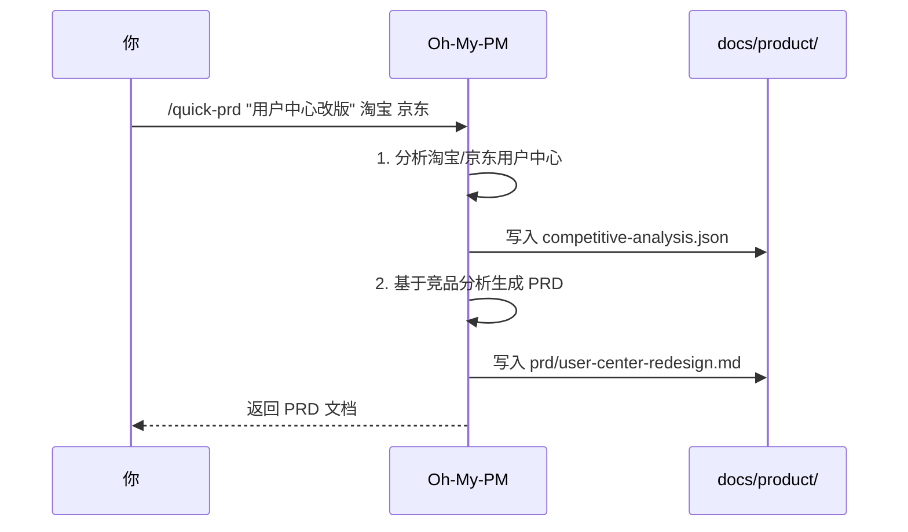
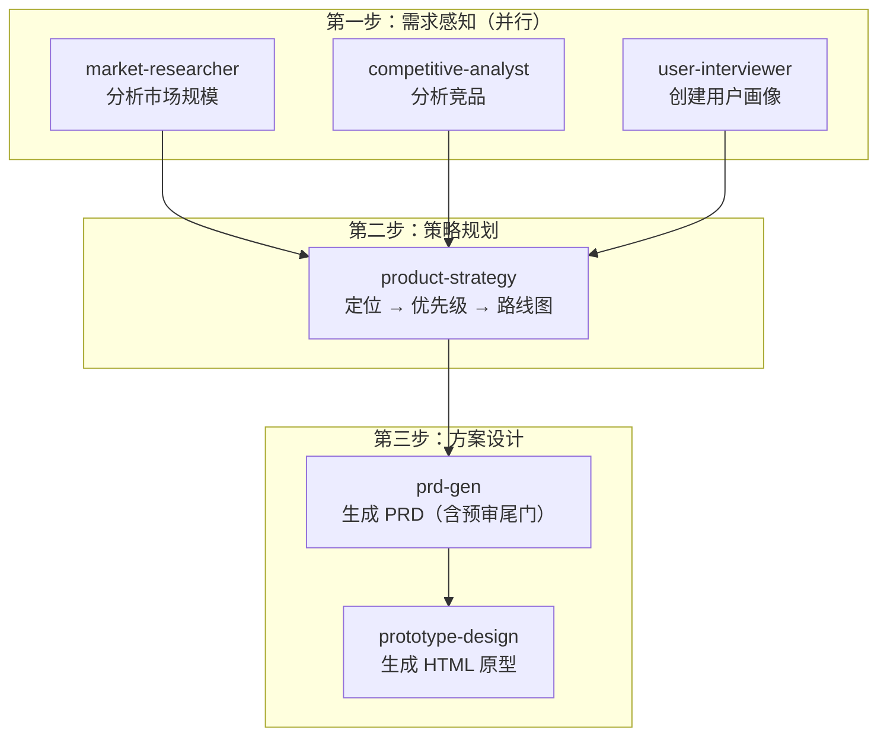
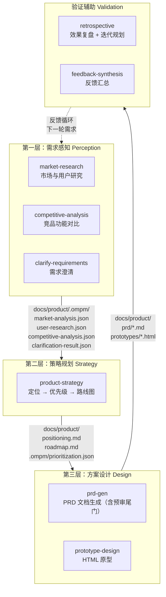
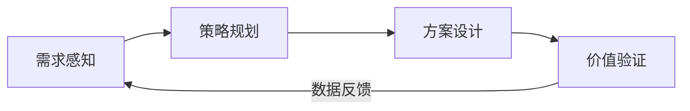

# Oh-My-PM 使用指南

面向产品经理的 Oh-My-PM 实操手册。

## 快速上手

### 安装

```bash
npx skills add kelegele/oh-my-pm -a claude-code
```

### 两种触发方式

| 方式 | 说明 | 示例 |
|:-----|:-----|:-----|
| **自然语言** | 直接对话，系统自动识别 | "帮我分析下 Notion 和飞书的差异" |
| **Command** | 斜杠命令直接调用 | `/quick-prd "需求描述" 竞品1 竞品2` |

---

## 使用场景导航

### 我刚接手一个产品

```
需求感知 → 策略规划 → 方案设计
```



1. **"分析一下 XX 行业的市场趋势"** → 自动调用 `market-research`
2. **"帮我分析 Notion vs 飞书的差异"** → 自动调用 `competitive-analysis`
3. **"基于这些分析帮我做产品定位"** → 自动调用 `product-strategy`
4. **"帮我写一份 PRD"** → 自动调用 `prd-gen`

### 我要快速出一个需求文档

直接用 `/quick-prd` 命令：

```
/quick-prd "用户个人中心改版" 淘宝 京东
```

执行流程：



### 我要从 0 到 1 做一个产品

用 `/full-pm-cycle` 命令：

```
/full-pm-cycle "新项目管理工具"
```

执行流程：



### 功能上线后要做复盘

```
效果复盘 + 迭代规划 → 反馈汇总
```

1. **"分析上线 7 天的效果数据"** → 自动调用 `retrospective`
2. **"汇总一下用户反馈"** → 自动调用 `feedback-synthesis`
3. **"基于效果帮我规划下一版"** → 自动调用 `retrospective`

---

## 三层主线 + 验证辅助

Oh-My-PM 的核心是 **三层主线（感知 → 策略 → 设计）+ 验证辅助** 的架构，共 12 个 Skill。每一层负责一个环节，层与层之间通过 `docs/product/` 目录传递数据。v1.0.0 起取消了独立的交付层：PRD 需求评审并入 `prd-gen` 的预审尾门，发布 checklist 与灰度策略并入 `feature-launch` 工作流。

### 整体数据流



### 各层处理详解

#### 第一层：需求感知 — "搞清楚现状"

**输入**：你的问题描述（"分析一下 XX 市场"）
**处理**：
- `market-research` → 分析行业规模、增长趋势、关键玩家，创建用户画像、识别痛点
- `competitive-analysis` → 功能对比矩阵、差异化分析
- `clarify-requirements` → 识别缺失信息、逐步确认、生成 PRD 内容方案

**输出**：`docs/product/.ompm/market-analysis.json`、`docs/product/.ompm/user-research.json`、`docs/product/.ompm/competitive-analysis.json`、`docs/product/.ompm/clarification-result.json`

**你该怎么用**：
> "这个市场有多大？趋势怎样？" → market-research
> "我的用户是什么样的人？" → market-research
> "帮我分析 Notion vs 飞书" → competitive-analysis
> "帮我梳理一下需求，还缺什么信息？" → clarify-requirements

#### 第二层：策略规划 — "定方向排优先级"

**输入**：感知层输出的市场数据、用户画像、竞品分析
**处理**：
- `product-strategy` → 一条主线走完：产品定位声明、价值主张 → RICE/MoSCoW 优先级排序 → 12 个月路线图与里程碑

**输出**：`docs/product/positioning.md`、`docs/product/roadmap.md`、`docs/product/.ompm/prioritization.json`

**你该怎么用**：
> "我们的产品定位是什么？" → product-strategy
> "先做哪个功能？" → product-strategy
> "接下来几个版本怎么排？" → product-strategy

#### 第三层：方案设计 — "把想法落地成文档和原型"

**输入**：策略层输出的定位、路线图、优先级
**处理**：
- `prd-gen` → 生成 8 章节 PRD（自动识别迭代/新功能/0-1 场景），生成后自动走预审尾门（自审清单 + 多视角挑战），替代旧的需求评审环节
- `prototype-design` → 生成可交互的 HTML 原型

**输出**：`docs/product/prd/*.md`、`docs/product/prototypes/*.html`

**你该怎么用**：
> "帮我写 PRD" → prd-gen
> "帮我画个原型" → prototype-design

#### 验证辅助：价值验证 — "上线后复盘"

**输入**：发布产物 + 实际运行数据 + 用户反馈
**处理**：
- `retrospective` → 上线 7-14 天分析目标达成度，基于效果 + 反馈制定下一轮迭代计划
- `feedback-synthesis` → 用户反馈主题分析

**输出**：`docs/product/.ompm/impact-analysis.json`、`docs/product/.ompm/feedback-synthesis.json`、`docs/product/.ompm/iteration-plan.json`

**你该怎么用**：
> "上线效果怎么样？" → retrospective
> "用户反馈了什么？" → feedback-synthesis
> "下一版怎么排？" → retrospective

### 反馈循环

验证环节完成后，迭代会重新启动第一层的感知流程，形成持续改进的闭环：



---

## 全部触发词速查表

### 需求感知层

| 你想说 | 触发词示例 | 调用的 Skill |
|:-------|:----------|:-------------|
| "这个市场有多大？" | 市场分析、行业趋势、市场研究 | `market-research` |
| "用户是什么样的人？" | 用户访谈、用户画像、用户研究 | `market-research` |
| "竞品做得怎么样？" | 竞品分析、对比、分析竞品 | `competitive-analysis` |
| "帮我梳理下需求" | 需求澄清、还缺什么信息、先确认需求 | `clarify-requirements` |

### 策略规划层

| 你想说 | 触发词示例 | 调用的 Skill |
|:-------|:----------|:-------------|
| "我们的产品定位是什么？" | 产品定位、差异化、价值主张 | `product-strategy` |
| "先做哪个功能？" | 优先级排序、需求优先级、RICE、MoSCoW | `product-strategy` |
| "接下来几个版本怎么排？" | 产品路线图、版本规划、路线图 | `product-strategy` |

### 方案设计层

| 你想说 | 触发词示例 | 调用的 Skill |
|:-------|:----------|:-------------|
| "帮我写需求文档" | 写 PRD、需求文档、PRD、产品需求 | `prd-gen` |
| "帮我画个原型" | 设计原型、原型、交互设计、wireframe、HTML 原型 | `prototype-design` |

### 验证辅助

| 你想说 | 触发词示例 | 调用的 Skill |
|:-------|:----------|:-------------|
| "上线效果怎么样？" | 效果分析、上线复盘、效果评估 | `retrospective` |
| "用户反馈了什么？" | 反馈分析、用户反馈、反馈汇总 | `feedback-synthesis` |
| "下一版怎么排？" | 迭代规划、版本排期、sprint planning | `retrospective` |

### 交付协调（v1.0.0 起取消独立层）

| 你想说 | 现在由谁处理 |
|:-------|:-------------|
| "组织一下需求评审" | `prd-gen` 预审尾门：PRD 生成后自动做需求预审 |
| "准备上线" | `/feature-launch` 工作流：发布 checklist + 灰度策略 + 上线后复盘 |

（原 `data-monitoring`、`project-coordination`、`process-optimization` 已随简化重构移除。）

---

## 产出物说明

Oh-My-PM 执行后会在 `docs/product/` 目录生成以下文件：

| 文件 | 说明 | 何时产生 |
|:-----|:-----|:---------|
| `docs/product/.ompm/competitive-analysis.json` | 竞品对比矩阵 | competitive-analysis |
| `docs/product/.ompm/market-analysis.json` | 市场分析数据 | market-research |
| `docs/product/.ompm/user-research.json` | 用户研究数据 | market-research |
| `docs/product/positioning.md` | 产品定位声明 | product-strategy |
| `docs/product/roadmap.md` | 产品路线图 | product-strategy |
| `docs/product/prd/*.md` | PRD 文档（带日期命名） | prd-gen |
| `docs/product/prototypes/*.html` | HTML 交互原型 | prototype-design |
| `docs/product/.ompm/current-workflow.json` | 工作流状态（自动追踪） | 所有 workflows |
| `docs/product/.ompm/impact-analysis.json` | 上线效果数据 | retrospective |
| `docs/product/.ompm/iteration-plan.json` | 迭代计划 | retrospective |

---

## 完整工作流 vs 独立 Skill

### 什么时候用 Command 工作流？

| Command | 适用场景 |
|:--------|:---------|
| `/quick-prd` | 快速出需求文档，自动带竞品分析 |
| `/full-pm-cycle` | 从 0 到 1 完整产品规划，一次性输出全链路产物 |
| `/feature-launch` | 功能发布全流程：发布准备（checklist/灰度）→ 上线 → 复盘 |
| `/ompm` | 全局意图路由：不知道下一步做什么时，让它推荐最有价值的下一步 |

### 什么时候单独用 Skill？

当你只需要做某一步的时候。比如：
- 已经知道竞品信息，只想写 PRD → 直接说 "帮我写 PRD"
- 只想分析竞品 → 直接说 "分析一下 XX 和 XX 的差异"
- 只想规划路线图 → 直接说 "帮我规划产品路线图"

---

## 常见问题

**Q: 可以用中文对话吗？**
A: 可以，所有触发词都支持中文。

**Q: PRD 生成的场景怎么区分的？**
A: `prd-gen` 自动识别三种场景：
- **迭代更新**：描述现有功能 + 迭代目标
- **新功能**：描述产品架构 + 入口位置
- **0-1 产品**：描述产品背景 + 参考竞品

**Q: 原型是怎么生成的？**
A: 直接生成 HTML 文件，保存在 `docs/product/prototypes/` 目录，可以用浏览器直接打开。

**Q: 上次分析的结果会被记住吗？**
A: 会。所有中间产出都保存在 `docs/product/` 目录，后续 Skill 会自动读取上下文。

**Q: 可以指定竞品吗？**
A: `/quick-prd` 支持在命令后追加竞品名称，如 `/quick-prd "需求" 淘宝 京东`。自然语言触发时直接说 "分析一下 A 和 B 的差异" 即可。
